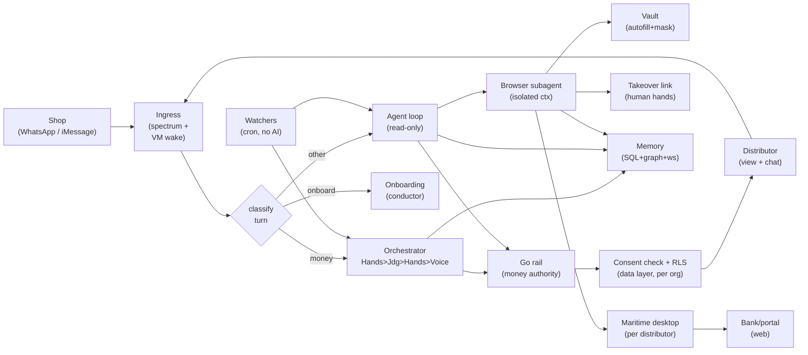
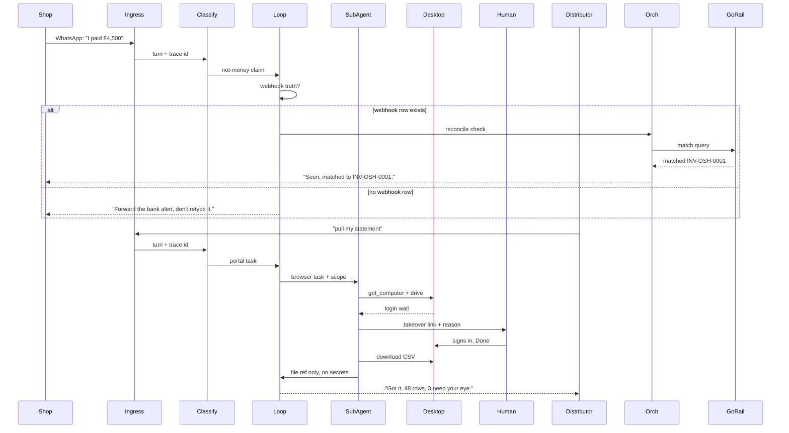
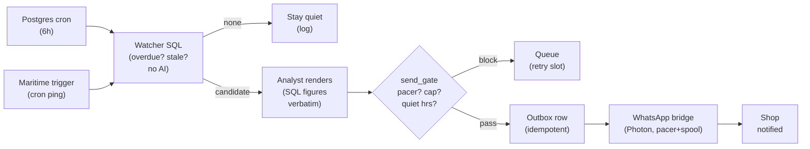

# MIRIAM Always-On Agent Architecture

> **RECONCILED (11 Oct 2026) with `MIRIAM-NETWORK-ARCHITECTURE.md`.** Agent/compute companion to the
> canonical network doc. See §9 for non-goals and §8 for resolved decisions.

**Date:** 11 Oct 2026 · **Status:** LOCKED, canonical agent architecture for the new product build · **Author:** architecture review
**Companions:** `MIRIAM-NETWORK-ARCHITECTURE.md` (canonical) · `docs/P0-PLAN.md` (build order).
The earlier pivot docs are removed as separate files; git history retains them.

**Sources for §2:** `Merit-Systems/OpenInstinct` (repo tree and README, Oct 2026) and `maritime.sh`
(`/agents.md`, `/docs/build`, `/docs/computers`, Oct 2026). Fit analysis, not vendored code.

**Session anchor:** workstream session `838b4c62` (SME pivot). The product is two-sided (see
`MIRIAM-NETWORK-ARCHITECTURE.md`): **shops** talk to Miriam on **WhatsApp** (iMessage via Photon is
secondary), and **distributors** get a web dashboard and their own computer. One shop, one book;
distributors connect to it. First wedge: *payment reconciliation for one Lagos distributor* (Oshodi
or Mushin route, first of Wigmore Trading, Renuzi Ventures, Funmi Stores, Betty Distribution, RSL
International to agree), with three v1 workflows: ingestion (WF-1), reconciliation (WF-2), one
reminder action (WF-3).
This doc answers: *what does "always-on agent with its own computer" mean for MIRIAM, and how do we
build it without touching the money core?*

---

## 1. Thesis

Today MIRIAM is a **stateless concierge**: a turn comes in over WhatsApp, the orchestrator reasons,
code decides, a reply goes out, and nothing persists except memory rows and ledger state.

The always-on agent is a different shape: **the distributor gets a persistent machine** (its own
micro-VM, its own disk, its own browser profile and logins, its own memory workstreams) that
watches, remembers, and acts on a schedule, and wakes in about a second when spoken to. Shops do
not each get a machine; they share a pooled, isolated browser profile, and only bigger shops get a
full computer (network doc §7.1).

The boundary that makes this safe:

> **The VM, browser, and desktop are a read-and-act surface. They can never move money.**
> Every figure the agent quotes comes from SQL/ledger rows. Every money movement still travels
> the one wired path (`Hands -> Judgment -> Hands -> Voice`) with confirm-id authority and an
> exactly-once journal. The machine gives the agent persistence and hands; it grants zero new
> financial authority.

Concretely: the distributor's agent lives on its own machine. It holds the reconciliation view,
remembers that "Mama Nkechi always pays Friday," pulls a bank statement from a portal when asked,
and nudges overdue shops over WhatsApp. When it needs a human, a login, a 2FA code, or a disputed
match, it hands the screen over and takes it back. When idle, it sleeps for free.

---

## 2. What we learn (and steal) from the two references

### 2.1 OpenInstinct -> MIRIAM: the assistant patterns

OpenInstinct is an open-source, self-hostable **personal iMessage assistant with a password vault**.
Its README is explicit that it is *not production software*, so we copy **patterns, not code**.

| # | OpenInstinct pattern (as built) | MIRIAM mapping (what we adopt) |
|---|---|---|
| O1 | **One agent core, many entry points.** `agent/agent.ts` serves `channels/{linq,eve,scheduled-run}`: iMessage, web, and scheduled runs are just ingress into the same brain. | Already ours: `api/spectrum.py` (iMessage/WhatsApp/terminal) plus `chat`/`stream` feed one orchestrator. **Keep; add the VM wake path as one more entry point, not a second brain.** |
| O2 | **Instructions as composable files.** `instructions/10-execution-safety`, `20-role`, `30-message-style`, plus role variants (`interactive`, `scheduled-worker`, `scheduled-report`). | Already our direction: the skills doc (§6) packages workflows as `SKILL.md` units with progressive disclosure. **Adopt O2's file-level composition as the authoring rule for every new skill.** |
| O3 | **Browser work quarantined in a subagent.** `subagents/browser-agent/` has its own tools, hooks, memory, and instructions; the main loop never touches a DOM. | **New build (P1):** a `browser-task` subagent with isolated context and its own toolset. Main loop narrates; subagent drives pixels. |
| O4 | **Vault that never leaks to the model.** `fill_from_vault` autofills at the browser layer; `vault-screenshot-mask` redacts secrets from screenshots; saved values are encrypted before they reach the database; the model never holds a password. | **New build (P1), the single most valuable idea for a money-touching agent.** Per-tenant encrypted vault injected at the browser layer, masked from screenshots and logs. Quotes and amounts come from ledger rows, never from vault reads. |
| O5 | **Memory workstreams.** `memory/workstreams.ts`: goals, decisions, observations, *unfinished steps* recalled across conversations; revision-guarded updates; explicit forget with tombstones; bounded recall (recent-first plus searchable archive). | **New build (P2):** extend `MEMORY-ARCHITECTURE.md`'s two-tier model with a workstream tier per tenant: `{goal, decisions[], observations[], open_steps[]}`, revision counter, same container isolation. |
| O6 | **Approval by default.** `ask_question` for ambiguity; **Link wallet** where each spend needs approval from the user's own wallet, available in interactive turns only, never in scheduled workers. | Already ours (`confirm_id` challenges; `APPROVAL_REQUIRED_ABOVE=0.0`). **Adopt O6's worker rule verbatim:** scheduled/watcher paths can *prepare* but never *approve*; approvals happen only in interactive turns or explicit human handover. |
| O7 | **Bought execution trio.** Kernel (cloud browsers) plus Google Workspace (Gmail/Calendar/Contacts via user-scoped OAuth, least-privilege scopes) plus private blob (memory, images, key material). | **Adopt the trio shape:** Maritime computers (browser/desktop) plus Google Workspace connector (P3) plus existing Postgres/Redis and blob for artifacts. Keep least-privilege OAuth (`gmail.modify`, never full mail). |

What we deliberately **do not** take: the Vercel-cron deployment shape (per-minute schedules need
Pro; our watchers live in Postgres cron plus Maritime triggers), the Eve-version-pinned session
store, or any application code.

### 2.2 Maritime -> MIRIAM: the compute

Maritime hosts **persistent agents, each in its own Firecracker micro-VM** (YC-backed). Two products:

**Agents**, one persistent machine per customer:

- Real micro-VM (own kernel, bare metal) with a **persistent disk at `/data`** that survives sleep,
  restart, and redeploy. Files, logins and packages persist; the disk is kept until the machine is
  deleted.
- **Boot ~0.5s; wake from sleep in about a second, mid-task.** Sleeping machines are **free** (flat
  plan, nothing metered), and a machine sleeps after 5 idle minutes.
- **Timers inside a sleeping VM do not fire**, so scheduled work uses Maritime **triggers** (cron).
  This matches our watcher design exactly (WF-3's Postgres cron emits; nothing polls inside an idle
  box).
- Deploy contract for a custom container: listen on `0.0.0.0:$PORT`, answer `GET /health` (2xx),
  answer `POST /chat {"message"}` within 30s, keep state under `/data`. SDK `provision()` is
  idempotent, so the same call on every sign-up returns the same agent.

**Computers**, one persistent headful Linux desktop per end user, driven over MCP by *our* model
(Claude/OpenAI/Gemini or our own loop):

- Loop: `get_computer(user_id)` once, then `computer` in a **screenshot, act, verify** cycle, plus
  `run_shell` (30s cap), `read_file`/`write_file` (under `/data` or `/home/desk`, 8 MiB cap), and
  `computer_batch` (up to 50 actions).
- **`request_takeover`** mints a control link for logins/2FA/CAPTCHAs/payments: the person takes
  the mouse, clicks Done, the agent continues. `takeover_status` polls; actions during handover are
  refused with `human_in_control` (retry, do not ask again).
- Sessions: 5-minute idle sleep, 30-second grace after close, memory snapshot kept 7 days, disk
  kept until deleted. Login persistence comes from the browser profile on disk.
- Security primitives we reuse: **pinned MCP URL** (`/mcp/u/<externalUserId>`, built from our org
  id, never model output), **computers-only key scope** (refused on every other endpoint), typed
  text never logged, short-lived viewer/takeover links.
- Pricing is flat per machine (verified 11 Oct 2026): **Starter $20/month for 20 machines, 5 awake
  at once; Growth $100/month for 100 machines, 25 awake at once; Scale $500/month for 500 machines,
  60 awake at once**; overflow $1.50/$1.25/$1.00 per extra machine. A machine asleep most of the day
  costs essentially its slot, not its actions (see §6). **The Computers product is early access.**

**Fit verdict:** Maritime is the managed answer to "each distributor gets its own computer." No
hypervisor to run, no browser farm to maintain, logins persist across weeks, sleep is free, and the
takeover primitive is exactly the human-in-the-loop our money rules demand. The Python and
TypeScript SDKs both cover provision, chat and exec, so the Go/Python split is unaffected (Python
orchestrates; Go stays the money authority).

---

## 3. Target architecture

### 3.1 System context (to-be)

*Legend: Jdg = Judgment; ctx = context; ws = workstreams; Go rail = RAIL_BACKEND.*

Reading the diagram: every turn still enters through one gateway and one classifier. The two
brains and onboarding are untouched. What is new is **right of the loop**: an isolated browser
subagent driving a per-distributor Maritime desktop, with the vault between the model and any
secret, and a takeover link for anything requiring human hands. Every distributor read passes
through the **consent check plus row-level security in the data layer** before it is serialized
(network doc §6.2); the UI never decides access. Below the line, **watchers** (plain scheduled
SQL, zero model calls) emit candidates into the orchestrator/loop, the "always-on" heartbeat.
Money still exits only through `GO`.

### 3.2 One turn, end to end (to-be)

Two rules visible in the sequence: a *typed payment claim* can never become a ledger row
(WF-1's fake-alert guard), and a *portal login* never touches model credentials. The human signs in
on the tenant's own desktop via takeover, and only a file reference returns. The bank statement
task belongs to the **distributor** (it is the distributor's own portal), which is why the second
half is driven by `X`, not the shop. The agent confirms the match and stops there: **restock and
credit decisions belong to the distributor.**

### 3.3 Always-on heartbeat (watchers as code, model as writer)

This is WF-3 generalized: **watchers detect, the model renders, code gates, the outbox proves.**
No model call on the detection path (p95 <1s, $0). No approval authority in the watcher (O6). The
exact-kobo assertion sits between `AN` and `GATE`: a rendered figure that differs from
`amount_kobo` blocks the send and logs a model failure.

---

## 4. How it bolts onto the existing core (invariants)

Nothing below changes. New surfaces route *into* the orchestrator, never around it.

| Invariant (today) | Where it lives | What the new build must not do |
|---|---|---|
| `Hands -> Judgment -> Hands -> Voice` is the only money path | `miriam_agent/orchestrator.py`, `STATUS.md` | No VM/desktop/worker path may settle, stage-settle, or pre-approve. The browser subagent has no rail tool. |
| Confirmations are Hands-issued `confirm_id`s; chat "yes" settles nothing | `orchestrator._handle_confirm` | Takeover "Done" is *portal access*, never *payment approval*. Approvals stay interactive-turn confirm-ids (O6). |
| Exactly-once journal (`reserved -> dispatched -> confirmed|failed`) | `database/models.py` (`MoneyExecution`) | Outbox keys (`reminder-{invoice}-{date}`), webhook stamps, one-match cardinality unchanged; VM wake/replay must return originals, never re-execute. |
| Amounts are kobo-int end-to-end; AI never computes | WF specs, MVP-7 gates | Skills `payment-reminder`, `reconciliation-explainer` stay `narrate-only`; `format_kobo` script runs, the model doesn't do math. |
| Grounding guard on egress; tool gate fails closed | `safety/grounding.py`, `judgment/gates.py` | Subagent outputs re-enter through the same gates. Screenshot text is untrusted data, never instructions. |
| Agent-loop registry is money-free by construction | `agents/agent_loop.py`, `tools/definitions.py` | Subagent toolset is `get_computer/computer/run_shell/read/write_file/request_takeover` plus reads. No rail, no ledger write, no vault plaintext read. |
| Memory carries facts, never balances | `MEMORY-ARCHITECTURE.md` §7 | Workstreams (O5) store goals/decisions/steps, never amounts. Money turns ingest scrubbed summaries only. |
| `ALLOW_CHAT_INFLOW_SYNTH=false`; Go is the money authority | compose, `integrations/go_client.py` | Pasted chat text still can't mint inflow; the VM can't either. Webhook truth only. |
| Per-turn budgets (steps/tokens/$/wall-clock) | `settings.py`, `agent_loop.py` | Browser loops get their own caps (screenshot-act rounds, `run_shell` 30s, batch 50) counted against the turn budget. |
| **The distributor owns the credit decision and the loss** | network doc §3, §6 | The distributor sets the credit limit, funds it and takes the loss. Miriam supplies evidence, credit-readiness reasons, recommendations and reminders only. **No Miriam code or model sets, raises or lowers a limit.** No computer, browser subagent, watcher or scheduled job may change consent or a limit either. The model never does the arithmetic. |
| **Durable money audit row is fail-closed; secondary sinks are fail-open** (Q1) | `m0/stop-the-bleeding`, `fix/audit-fail-closed` (commit `f99eb6a`), not yet merged into this checkout | Write the durable money audit row **in the same DB transaction as the settlement**. If it cannot be written, nothing settles: return 5xx so the webhook retries, and idempotency stops a double count. OTel, Langfuse and analytics are **secondary sinks** and stay fail-open, retried through the outbox. A broken durable store means no receipt and a retry; a broken secondary sink still settles. |
| **Inbound payment dedupe is a structured key, never a text hash** (Q2) | `PaymentReference` at `miriam_agent/database/models.py:265` and `alembic/versions/001_baseline.py` on `m0/stop-the-bleeding`; helper `inflow_id_for_alert` at `miriam_agent/orchestrator.py:1059`, used by `api/chat.py` and `api/spectrum.py:497` | Unique on `(channel, sender_handle, amount_minor, reference)`. The committed schema adds `payload_hash` to that key, so two wordings of one transfer become two rows. Drop `payload_hash` from the key (keep it as a plain column) and wire the verified-credit flow to write the row. Until then no payment may be called verified. |
| **Computers are workers, not storage** | network doc §7.2 | The shop's book and all ledger data live in central Postgres with row-level security. A computer holds only that tenant's working files and sessions. Deleting a computer must never delete a record. |
| **WhatsApp is Cloud API only** | network doc §2, §5 | Never run WhatsApp through a browser VM. Inbound is the Meta Cloud API via the Photon Spectrum bridge, verified with `X-Hub-Signature-256`. |

Known construction hazards (from the infra doc): single-process ledger risk (one worker per
container for money routes until G1 is fixed), regex classifier brittleness on Pidgin and caption
money sentences (golden-set the classifier before camera-till), and `Float` projection columns
(kobo-int assertions at every new boundary).

Note: an earlier draft said "no Alembic yet". Alembic, the `PaymentReference` model and the audit
fail-closed wiring exist on `m0/stop-the-bleeding` (commit `f99eb6a`, PR #30) but are **not merged
into the current branch (`d8d79f8`)**. Merging them is a P0 prerequisite (`docs/P0-PLAN.md`).

---

## 5. Security and isolation model

1. **One computer per distributor, pooled isolated profiles for shops.** The distributor gets its
   own computer; shops share a pooled, isolated browser profile (a full computer only for bigger
   shops). Shop scoping ("drawers") is enforced in SQL, so cross-shop match/send is impossible by
   construction, defense in depth. Every distributor read also passes the consent check plus
   row-level security in the data layer (network doc §6.2). Whether one tenant's computer can reach
   another is **unverified**: add it as an explicit question to the Maritime processor agreement
   (item 9 and Q5).
2. **Vault at the browser layer (ours).** Secrets are stored **encrypted at rest, per tenant**, and
   autofilled by the desktop at the browser layer. They **never reach the model, the logs or
   memory, and they are masked from screenshots** (O4). The model holds a reference, never a value.
   Vault plaintext is never a tool result, never memory, never a log line.
3. **Pinned identity.** The MCP URL is built server-side from the **org ID** as `externalUserId`
   (`/mcp/u/<org-id>`), so it is **one computer per distributor org**. It is never a staff user ID
   and never model output; a conflicting id is refused. The Maritime key issued to the agent loop
   carries the **computers-only scope**, so a leak reaches desktops, never billing, agents or keys.
4. **Takeover, not passwords.** Logins/2FA/CAPTCHAs go through `request_takeover` links
   (short-lived, single-desktop, revoked on close, sleep or completion). Staff never dictate
   credentials into chat.
5. **Secrets live in Maritime env, never the repo.** Webhook HMAC secrets, provider keys, and
   per-tenant tokens are set via `env set --reload` after provisioning. A missing HMAC secret fails
   boot (WF-1).
6. **Least-privilege connectors.** Google Workspace via user-scoped OAuth with minimal scopes;
   tokens stored by the connector, only stable identity stored by us. Spend approvals follow the
   Link shape: interactive turns only, per-action grant, expiring links (O6/O7).
7. **Audit continuity and the policy split (Q1).** The durable money audit row is **fail-closed**:
   written in the same DB transaction as the settlement, and if it cannot be written nothing
   settles (return 5xx so the webhook retries; idempotency stops a double count). Secondary sinks
   (OTel, Langfuse, analytics) are **fail-open**, retried through the outbox. Every watcher
   emission, analyst render, gate verdict, outbox write, and takeover carries the
   `X-Miriam-Trace-Id`; receipts reference mandate ids when the AP2-shaped envelope lands (G5).
   Scope-elevation events (approval issued, takeover completed) are logged with token claims and
   trace id. Commit `f99eb6a` states fail-closed on `fix/audit-fail-closed`, but the test at
   `tests/test_money_layers_route_live.py:448` still asserts fail-open; rewriting that test to match
   this split is P0-2 in `docs/P0-PLAN.md`.
8. **Shop identity is a WhatsApp number plus a device binding (Q8).** Reuse the **pattern** of
   `migrations/081_create_device_bound_sessions.up.sql` (binding hash, expiry, revoke, risk score)
   from `user_sessions` and `device_binding_audit`, but **not as is**: those are keyed on app users
   and browser fingerprints, and WhatsApp gives no device id. Key the binding on the **member** plus
   WhatsApp's **identity signal**, and enable the Cloud API identity-change notice. Treat a change
   as a new device: re-verify, then a 24-hour cooling-off on sharing and credit actions.
9. **Data location is a written dependency (Q5).** Email `contact@maritime.sh` for the data location
   and a processing agreement, **in writing**, before any shop is onboarded. Add two open questions
   to that agreement: where data is stored and processed, and whether one tenant's computer can
   reach another. The first drives the NDPA cross-border position (network doc §10); both are
   currently unverified.
10. **Field-level protection.** Encryption in transit (TLS 1.2+, HSTS) and at rest. Field-level
    encryption for phone numbers, names and account numbers, keys in a managed KMS. Private photo
    storage with short-lived signed URLs, and **image metadata stripped before a distributor ever
    sees the image**, after integrity checks have used it.
11. **NDPC registration, DPO and DPIA before onboarding (Q10).** Reported NDPC tiers run from above
    200 data subjects in 6 months (OHL), above 1,000 (EHL), above 5,000 (UHL), and fintechs are
    named under UHL in the NDPC notice. Shops, staff, debt-book customers and distributor users will
    pass 200 within the pilot, so registration is required **before the first shop is onboarded**;
    counsel to confirm the tier (network doc §10). The **founder is the pilot DPO**, and the **DPIA
    must be reviewed by Nigerian counsel before the first shop is onboarded**.
12. **WhatsApp is Cloud API only.** Never run WhatsApp through a browser VM, at any phase. Inbound
    is the Meta Cloud API delivered through the Photon Spectrum bridge, verified with
    `X-Hub-Signature-256`.
13. **Kill switch, expiring sessions, screenshot discipline.** A per-tenant kill switch wipes one
    tenant's desktop and revokes its access. Saved sessions expire, and takeover and viewer links
    are short-lived. Screenshots are minimised (capture only when needed) and masked for secrets.

---

## 6. Cost model

Two ledgers: **Maritime machines** (flat) plus **model calls** (metered). The design minimizes both.

| Cost | Shape | Merchant-agent math |
|---|---|---|
| Maritime slot | Flat per machine/month; sleeping is free; timers via triggers, not idle VMs. Paid from the **Rail Technology Concepts Ltd** account on **Starter ($20/month)**; the Maritime for Startups application was submitted 11 Oct 2026 (Q5). | 1 machine per distributor (a computer is the same unit as an agent); shops share a **pooled, isolated browser profile**, not a VM. At Starter (20 machines), one distributor costs a couple of dollars per month before overflow. |
| Watcher SQL | $0 (no model calls on WF-1/WF-2/WF-3 detection) | 6-hourly cron plus reconcile jobs run on existing Postgres/Go workers. |
| Analyst render | 1 LLM call per candidate, capped by pacer and cooldowns | Bounded by per-shop daily caps plus 12h dedupe; $0.05/turn discipline holds (existing `AGENT_COST_USD` plus per-skill attribution G14). |
| Browser session | Model calls per screenshot-act round, capped | Only on explicit portal tasks (P1+); round cap plus `run_shell`-first discipline (prefer shell over pixels). |
| WhatsApp delivery | Meta Cloud API via the Photon Spectrum bridge (`whatsappBusiness.config`, our own token and phone number id); template and 24h-window cost rows apply | The channel cost center; batch the day and keep over 80 percent reactive (network doc). Start Meta verification now (Q4). |

This keeps the PRD's pilot cost card (at or below N2,900 per shop per week, all in) intact: the
infra line is dollars per distributor per month, the variable line is pennies per reminder, and
sleep is free.

---

## 7. Phased rollout (each shippable, each gated)

- **P0: merge the m0 foundation, then reconciliation and reminder MVP (no VM).** First merge
  `m0/stop-the-bleeding` / `fix/audit-fail-closed` (audit fail-closed, `PaymentReference`, Alembic
  baseline) and `eval/capability-gate` (the 124-capability catalog from session `70286b98`, Q3),
  then drop `payload_hash` from the payment unique key (Q2) and wire the verified-credit flow. Then
  ship WF-1/2/3 on the current stack. **Start Meta business verification this week** (Rail
  Technology Concepts Ltd owns the Meta Business account; upload the CAC documents; expect days to a
  couple of weeks, Q4). Gates: `docs/P0-PLAN.md` P0-1 to P0-7. *This is the World's Fair demo
  surface.*
- **P1: browser subagent and vault, one workflow.** Build the isolated `browser-task` subagent (O3)
  plus the per-tenant vault with screenshot masking (O4) plus one `browser-task` skill. First task:
  pull a bank/portal statement via `request_takeover` (the human signs in on the Maritime desktop,
  the CSV lands under `/data`, only a file reference returns). Gates: skill-contract test plus
  trigger matrix; vault-mask test (no secret bytes in screenshots, logs or memory); takeover
  round-trip test.
- **P2: persistent per-distributor VM and memory workstreams.** Provision one Maritime agent per
  distributor (idempotent `provision()` on onboarding); migrate watchers to cron triggers; add the
  workstream memory tier (O5) with revision guards. Gates: wake-latency SLO (about 1s), sleep-free
  billing check, workstream recall eval, replay-still-harmless proof across VM sleep.
- **P3: Workspace, Link-style approvals, WhatsApp maturity, and credit.** Google Workspace
  connector (Gmail/Calendar/Contacts, least-privilege OAuth); spend approvals in the Link shape on
  interactive turns (O6); WhatsApp **maturity** (utility templates, the 24h-window clock, and
  per-message cost rows) since WhatsApp is already live from P0 as the primary channel; AP2-shaped
  open/closed mandate envelope around confirm-ids (G5); Go tool manifest (G7). Credit (policy,
  limits, reminders, no pay no restock) also lands here per the network doc, with the distributor
  funding the limit and taking the loss. Gates: OAuth scope audit, approval-expiry tests, WhatsApp
  cost-cap tests, mandate-chain receipts.

Skills added along the way (all per the existing skills design, teach and never enforce):
`browser-task` (P1), `vault-autofill` (P1), `workspace-triage` (P3); `payment-reminder`,
`reconciliation-explainer`, `proactive-analyst` already specified. Non-AI paths (ingestion,
matcher, sweeper, gates, outbox) get **no skills**: zero model calls there is the feature.

---

## 8. Resolved decisions (11 Oct 2026)

The questions raised in the network-doc draft are answered by the owner. These are now decisions,
not open items.

| # | Question | Decision |
|---|---|---|
| Q1 | Audit fail-closed or fail-open? | **Both, split by sink.** Durable money audit row is **fail-closed**, written in the same DB transaction as the settlement; if it cannot be written, nothing settles and the webhook retries (idempotency stops a double count). Secondary sinks (OTel, Langfuse, analytics) are **fail-open**, retried via the outbox. Rewrite `tests/test_money_layers_route_live.py:448` to match. Commit `f99eb6a` already says fail-closed; the test is the stale side. |
| Q2 | Does `payment_references` exist? | **Yes**, on `m0/stop-the-bleeding`: `PaymentReference` at `miriam_agent/database/models.py:265` and `alembic/versions/001_baseline.py`, keyed `(channel, sender_handle, amount_minor, reference, payload_hash)`. The `payload_hash` claim came from that line. **Nothing writes it**; production still dedupes on `inflow_id_for_alert` text hashes (`orchestrator.py:1059`, used at `api/spectrum.py:497`). Fix: a migration that drops `payload_hash` from the key (keep it as a column), then wire the verified-credit flow to write the row. |
| Q3 | Where is the capability gate? | Done in session `70286b98-cfcf-441e-b266-1469c0e18770`; the 124-capability catalog is on branch `eval/capability-gate` (`eval/capabilities.json`). |
| Q4 | Photon or Meta directly? | **Both, in layers.** The **Meta Cloud API**, delivered through **Photon's Spectrum bridge** (`whatsappBusiness.config` with our own token and phone number id). Rail Technology Concepts Ltd owns the Meta Business account and verification; start it this week with the CAC documents; expect days to a couple of weeks. |
| Q5 | Maritime data location and plan? | Email `contact@maritime.sh` for the data location and a processing agreement, in writing. Pay from the Rail Technology Concepts account on **Starter ($20/month)**. The **Maritime for Startups application was submitted 11 Oct 2026 from tobilobaomotade@userail.money**, awaiting reply; if declined, the Starter plan stands. |
| Q6 | 12-month retention? | Counsel. Send them the DPIA. Nothing in P0 depends on it. |
| Q7 | Fees tied to credit outcomes? | Counsel. Nothing in P0 depends on it. |
| Q8 | Reuse migration 081 for SIM-swap? | **Pattern yes, as is no.** `user_sessions` and `device_binding_audit` fit (binding hash, expiry, revoke, risk score) but are keyed on app users and browser fingerprints, and WhatsApp gives no device id. Key the binding on the **member** plus WhatsApp's **identity signal**, and enable the Cloud API identity-change notice. Treat a change as a new device: re-verify, then 24-hour cooling-off. |
| Q9 | Distributor and route? | Owner's call. Rule: the first of the five to agree, on Oshodi or Mushin. |
| Q10 | Controller of major importance? | Almost certainly **yes**. Reported NDPC tiers: above 200 data subjects in 6 months (OHL), above 1,000 (EHL), above 5,000 (UHL); fintechs are named under UHL in the NDPC notice. Shops, staff, debt-book customers and distributor users pass 200 within the pilot. Counsel to confirm the tier, and **register before onboarding**. |

### Remaining open (design-level, not blocking P0)

1. **VM-per-distributor vs VM-per-shop at scale.** P2 provisions per distributor; shops share a
   pooled browser profile. Revisit when a second distributor onboards or awake-at-once caps bind.
2. **Statement parsing ownership.** P1 returns a CSV reference; whether Python deterministic code
   or Go workers own row-level parsing is decided in the P1 build against the trust-pipeline rules
   (cleared-only accounting, quarantine plus clarification loop).
3. **Workspace write scope.** Read-only (summarize threads, find invoices) in P3 v1; send-as-user
   only after a dedicated approval story exists.
4. **Distributor-authored skills (Phase 2).** Custom reminder voices need the sandbox plus audit
   story first (untrusted-skill review, read-only until reviewed).
5. **A2A between org agents.** Design-only until a second agent exists to negotiate with.
6. **Cross-tenant computer reach.** Whether one tenant's computer can reach another is unverified;
   add it to the Maritime processor agreement (items 1 and 9, Q5).

## 9. Explicit non-goals

Two different lists, kept separate so nothing on the roadmap is mistaken for a product non-goal.

### 9.1 Out of the 30-day pilot (on the roadmap, later phases)

- **Credit actions.** The distributor dashboard v1 already ships a **credit page with
  credit-readiness reasons**, but acting on credit (limits, reminders, no pay no restock) lands in
  **P3**. The pilot keeps credit **read-only** until verified data matches the distributor's records.
- **Multi-distributor and multi-market scale** beyond the one Oshodi or Mushin route.
- **Full camera-till intake** (Document AI or VLM reading of till photos). The pilot reads **weekly
  stock-book and shelf photos** (checked) and typed or voice sales (self-reported).
- **Point-of-sale fake-transfer confirm** ("give him the goods" YES/NO, v2).
- **WhatsApp cost-control maturity** (utility templates, the 24h-window clock, per-message billing).
- **USSD.**
- **Uplift-share or outcome billing.** The pilot proves the loop against the cost card.

### 9.2 Out of the product (not on the roadmap)

- **Miriam lending its own money, holding stock or running trucks.** Never. The distributor funds
  any credit and takes the loss.
- **AI setting, raising or lowering a credit limit, or doing money arithmetic.**
- **A native desktop app** for Windows or Mac. The distributor surface is the web dashboard.
- **Running WhatsApp through a browser VM.** Cloud API only.

### 9.3 Not non-goals (explicitly in scope)

- **Stock is core.** Every shop's book uses `sold = opening stock + deliveries received - closing
  stock`, from weekly stock-book and shelf photos plus distributor deliveries.
- **Voice notes are retained** (Pidgin, Yoruba, Hausa, Igbo).
- **The distributor dashboard credit page with credit-readiness reasons** is in v1.
- **WhatsApp is the primary channel**; iMessage stays secondary via Photon.
