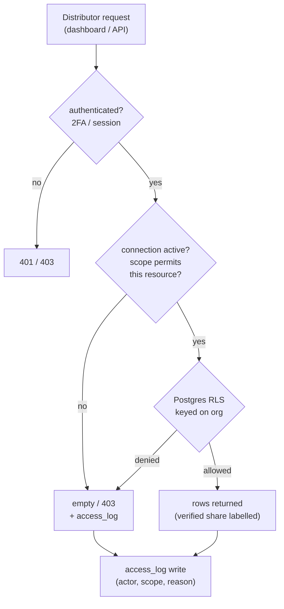
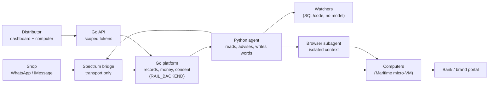

# MIRIAM Network Architecture (canonical)

**Date:** 11 Oct 2026 · **Status:** CANONICAL. Supersedes conflicting sections of the earlier
pivot docs (see Appendix A). **Owner:** Rail Technology Concepts Ltd. **Author:** lead architect.

**Companions (do not delete, some sections superseded):** `MIRIAM-SME-PIVOT-PRD.md`,
`MIRIAM-SME-PIVOT-TECHNICAL-REQUIREMENTS.md`, `MIRIAM-SYSTEM-DESIGN-ARCHITECTURE.md`,
`MIRIAM-WORKFLOW-SPECS.md`, `MIRIAM-AGENT-INFRASTRUCTURE-AND-SKILLS-ARCHITECTURE.md`,
`MEMORY-ARCHITECTURE.md`, `MIRIAM-ALWAYS-ON-AGENT-ARCHITECTURE.md`, `STATUS.md`,
`Miriam-Distributor-Network-Design.pdf` (draft v0.2, this doc supersedes it).

**Evidence discipline.** Claims about this repo were checked by reading files, cited inline.
Claims about an external provider are marked **[ext]** and were checked against its live docs on
11 Oct 2026; anything unverifiable is marked **[unverified]** with the reason. Opinions are marked
**[opinion]**. Plain words, no em dashes.

**Scope of this task.** Docs and plan only. No application code changed.

---

## 0. Verification notes (read first)

Four things in the brief could not be confirmed against the code, and one conflicts with a test.
They are flagged here, not resolved silently:

1. **Audit fail-open vs fail-closed. RESOLVED (Q1).** The brief required a fail-closed audit write;
   the test `tests/test_money_layers_route_live.py:448`
   (`test_a_failing_audit_sink_never_breaks_a_settled_turn`) asserted the opposite. Q1 splits the
   policy by sink: the durable money audit row is fail-closed in the settlement transaction, and
   secondary sinks are fail-open via the outbox. The test is rewritten in P0-2. See Appendix A row C6.
2. **`eval/capabilities.json` is not on this branch, but it exists.** The 124-entry catalog is
   committed on branch `eval/capability-gate` (`eval/capabilities.json`), from session
   `70286b98-cfcf-441e-b266-1469c0e18770` (Q3). Recover it from there; do not rebuild it.
3. **`capability-gate.patch` is not in this working tree.** The gate work is on `eval/capability-gate`;
   apply it from that branch (Q3). It cannot be applied from this checkout as is.
4. **`payment_references` exists, but not on this branch and not wired (Q2).** `PaymentReference` is
   at `miriam_agent/database/models.py:265` on `m0/stop-the-bleeding` / `fix/audit-fail-closed`
   (commit `f99eb6a`, PR #30), with the Alembic baseline at `alembic/versions/001_baseline.py`. Its
   unique key is `(channel, sender_handle, amount_minor, reference, payload_hash)`, so the
   `payload_hash` claim is confirmed: two wordings of one transfer become two rows. **Nothing writes
   the table**; production still dedupes on `inflow_id_for_alert` text hashes (`orchestrator.py:1059`,
   used at `api/spectrum.py:497`). **None of this is merged into this checkout (`d8d79f8`).**

I did **not** run the test suite: `timeout` is unavailable on this macOS shell and a `uv run pytest`
invocation exceeded the 60s tool budget before returning. The three failing tests named in the brief
are assumed to fail as reported but are marked **[unverified]** by me. The CI facts below come from
the brief plus file reads, and the P0 plan re-verifies them as its first ticket.

---

## 1. Summary

Miriam becomes a **two-sided business data and trust platform** for Nigerian informal retail.

- **Shops** (provisions, FMCG, drinks, building materials) talk to Miriam on **WhatsApp**. iMessage
  via Photon is a **secondary** channel, never the only one. Most Lagos traders are on Android and
  WhatsApp. **[ext][opinion]** Meta business verification is the gating item for WhatsApp and must
  start now (P0).
- **Distributors and brands** get a **web dashboard** and their own **agent-controlled computer**.
- Miriam is the **trusted data layer** between shops and distributors. It is **not** a marketplace.
  It never lends its own money, holds stock, or runs trucks. The distributor pays and funds any
  stock credit.

**Positioning:** "Miriam helps shops keep reliable records and helps each distributor make safer
restocking and credit decisions, while the shop controls who sees its data."

**Why this shape. [opinion]** The trust asset is the **verified shop record**, not GMV. Sabi (Lagos)
scaled an FMCG marketplace and later pivoted toward commodity traceability; the lesson taken is to
work **with** distributors as their data layer and to stay asset-light, earning from verification,
dashboards and credit outcomes rather than a margin on goods. GMV is not revenue and Miriam should
never be compared to a marketplace's GMV as if it were income.

---

## 2. Who uses it

| Role | Channel | Does | Can never |
|---|---|---|---|
| Shop owner | WhatsApp (iMessage via Photon where it exists) | Records, asks, approves sharing, sees everything about their shop | See another shop's data |
| Shop staff | WhatsApp, linked by the owner | Logs sales and deliveries, sends stock photos | See profit, delete records, share data, change prices |
| Distributor admin | Web dashboard | Invites shops, sees connected shops, sets credit policy, manages team | See data a shop did not share, or competitors' data |
| Distributor rep | Dashboard (mobile web) | Sees shops on their route, logs visit counts and deliveries | See shops outside their route, or change credit limits |
| Miriam ops (us) | Internal admin | Support, fraud review, eval labelling | Read shop data without a logged, reasoned, time-limited access grant |

---

## 3. Locked decisions (11 Oct 2026)

These are fixed. Everything below is consistent with them.

1. **One Miriam per shop, one book.** Distributors **connect** to a shop's book. They never own it.
   Each distributor gets a **branded invite link** that lands in the same Miriam.
2. **A shop can connect to many distributors.** The shop chooses what each sees. **Default
   distributor scope:** sales and stock of *that distributor's own products*, payments to it,
   credit-readiness score with plain reasons, and the shop's **total debt across all distributors**
   (amount only, never who it is owed to). **Never:** competitors' data, shop profit, expenses,
   customer debts or private notes. **Revoke with one message, effective immediately.**
3. **Photos and voice notes kept 12 months**, then deleted. Ledger and audit records kept as law
   and credit agreements require (counsel to confirm).
4. **Pilot:** one distributor (first of Wigmore Trading, Renuzi Ventures, Funmi Stores, Betty
   Distribution, RSL International to agree), **20 to 30 shops**, one route (Oshodi or Mushin),
   30 days.
5. **First verified payment source:** one **static NGN account per shop**, matched by **sender plus
   amount**. Mono bank feed in phase 2.
6. **Founder is DPO** for the pilot. A DPIA exists and needs **Nigerian counsel sign-off** before
   the first shop is onboarded.

---

## 4. Data recording and trust

### 4.1 The sell-through rule

Shops do not log every sale. For each product and period:

```
Sold = opening stock + deliveries received - closing stock
Revenue = sold x price
```

- Deliveries come from distributors, so the shop types nothing.
- Stock counts are one set of photos a week, plus spot checks.
- The transfer part of revenue is matched to verified credits. The rest is cash.
- Shops that want daily detail may still log by text or voice note. Those entries are labelled
  **self-reported** and used for advice, **never for credit**.

### 4.2 Sources and trust levels

| Source | How it arrives | Trust level |
|---|---|---|
| Distributor deliveries | Distributor invoice or dispatch record, by dashboard, upload or API | **Verified** (the distributor is the source) |
| Bank or virtual-account credits | Static NGN account per shop, or a bank feed (Mono) | **Verified** |
| Rep visit counts | Logged by the distributor rep on site | **Verified** |
| Stock counts | Photos of the stock book or shelves, read by Miriam, confirmed by the shop | **Checked** (verified when backed by a spot check or rep visit) |
| Bank alert screenshots | Forwarded by the shop | **Unverified** until matched to a real credit |
| Typed or voice-note sales | Shop owner or staff | **Self-reported** |
| Cash sales | Derived (sell-through minus verified transfers) | **Derived** |

### 4.3 Status labels (use exactly these)

Every number carries its label. Never write "verified sales" without evidence. The status vocabulary
is: **Reported, Matched, Confirmed, Unmatched, Needs review**. This refines the older
`matched / unpaid / needs_review` vocabulary in `MIRIAM-WORKFLOW-SPECS.md` (superseded there; see
Appendix A row C7).

### 4.4 Making capture easy

- One photo of a stock book page. Miriam reads it and asks only about rows it is unsure of.
- Voice notes in Pidgin, Yoruba, Hausa or Igbo, including market noise.
- Local units (carton, pack, bag, paint rubber, mudu) and money slang ("2k5").
- Weekly count reminder at the shop's chosen time, never during quiet hours.
- Onboarding imports old stock book pages so the shop has history on day one.

### 4.5 Append-only records

Records are append-only. Corrections are **new entries** carrying: who, when, channel, old value,
new value, reason and evidence. Nothing is edited in place. This is the same immutability stance as
`STATUS.md` ("immutable audit trail") and the Go ledger hash chain
(`RAIL_BACKEND` migration 283, credited via `AGENTS.md`).

---

## 5. Integrity controls (stopping inflation)

Once credit depends on reported sales, some shops will inflate them. These controls make inflation
either impossible or visible. Flags go to a **review queue** and to the distributor as "needs
check". **Miriam never accuses a shop. It asks.**

| Control | How it works | Catches |
|---|---|---|
| Delivery cap | A shop cannot sell more of a product than it received across **all** connected suppliers, plus opening stock | Invented sales |
| Money match | Claimed revenue is compared with verified credits plus an expected cash share for that shop type | Sales with no money behind them |
| Random spot checks | Miriam asks for a photo of one named shelf "now", and checks image time, device and location metadata against the shop | Fake stock counts, reused photos |
| Photo reuse check | Perceptual hash of every stock photo, compared with the shop's past photos and all shops' photos | Resending old or borrowed photos |
| Rep visit counts | Distributor reps count a few items on random visits | Drift between claimed and real stock |
| Jump detection | Sudden sales or stock jumps, especially before a credit request, are flagged for review | Gaming before a credit decision |
| Cross-distributor consistency | Total stock received across all connections must explain the stock counted | Hiding a supplier to look smaller or bigger |
| Verified share label | Every dashboard number shows its verified percentage | Over-trusting self-reported data |
| Credit on verified only | Limits are computed only from verified and checked data | Removes the payoff for inflating |

---

## 6. Tenancy, consent and access

### 6.1 Entities to add

The current Python schema (`miriam_agent/database/models.py`) has **no** org, connection, consent or
tenant model. It has `User`, `FinancialProfile`, `Transaction`, `Investment`, `Budget`,
`Conversation`, `Message`, `MemoryEntry`, `ChannelIdentity`, `AuditLog`, `MoneyExecution`,
`ToolUsage` [verified by reading the file outline]. The network needs these new entities:

| Entity | Key fields |
|---|---|
| `org` | id, type (shop or distributor), legal name, CAC number (distributors), status |
| `member` | org_id, user_id, role, invited_by, status |
| `shop_profile` | org_id, shop name, market, area, geo (coarse), category |
| `connection` | shop_org_id, distributor_org_id, status, scope (JSON, versioned), created_at |
| `consent` | connection_id, granted_by, scope_version, wording_hash, channel, granted_at, revoked_at |
| `product` | shop catalogue item, unit, pack size, mapped distributor SKU |
| `delivery` | distributor_org_id, shop_org_id, lines, invoice ref, source (verified) |
| `stock_count` | shop_org_id, lines, photo hashes, method, trust level |
| `payment_reference` | channel, sender, amount_minor, reference; **unique on these, NOT on raw text hash** |
| `credit_line` | connection_id, limit, terms, balance, policy_version |
| `integrity_flag` | shop_org_id, type, evidence, status, reviewer |
| `access_log` | actor, org, resource, scope used, reason, timestamp |
| `computer` | tenant, provider id, status, session expiry |

**Note on `payment_reference`:** the docs currently propose dedupe on a `payload_hash`
(`MIRIAM-SYSTEM-DESIGN-ARCHITECTURE.md:281`, `MIRIAM-MASTER-GUIDE-SIMPLE.md:315`). This doc
supersedes that: the unique key is `(channel, sender, amount_minor, reference)`, so two genuinely
different payments from the same sender for the same amount still reconcile, while a replayed
webhook collapses. See Appendix A row C5 and Open Question Q2.

### 6.2 The consent check (one place, in the data layer)

Every distributor query passes through **one** scope check in the data layer plus **Postgres
row-level security keyed on `org`**. The UI never decides access.



Rules that make this enforceable:

- Consent is stored as **data**, with the exact wording shown and its version (`wording_hash`).
- Changing the default scope wording creates a **new version**. Existing connections keep their old
  scope until the shop re-agrees.
- **Revoking cuts access immediately.** Already-shared aggregates stay with the distributor only as
  far as the agreement says. This must be stated clearly at consent time.
- Every distributor read is written to `access_log`. Shops can ask "who has seen my data?" and get
  an answer.

### 6.3 Connections

A connection links one shop to one distributor, with a status (invited, active, paused, revoked), a
versioned scope, a consent record, and an optional credit line. A shop can hold any number of
connections; a distributor can hold any number of shops. Separate Miriam numbers per distributor
were considered and rejected for v1: the record would split, inflation would hide per slice, shops
would juggle several "Miriams", and more WhatsApp numbers cost more to verify and run. What is kept
from that idea: each distributor gets its own **branded invite link and entry message** ("Wigmore
uses Miriam to manage your credit"), landing in the shop's one Miriam.

---

## 7. Computers (agent-controlled machines)

### 7.1 What each tenant gets

- **Distributor: its own persistent computer.** Uses: pull bank statements via the human takeover
  link, work brand and manufacturer portals, update the distributor's existing Excel or web
  accounting, produce shop statements and route sheets, prepare VAT and PAYE figures for owner
  review, build credit packs, morning and weekly reports.
- **Shop: a private, isolated browser profile on a shared pool by default.** A full computer only
  for bigger shops that run software worth driving (POS export, Moniebook, online listings, B2B
  ordering apps).

### 7.2 Computers are workers, not storage

The shop's book and all ledger data live in **central Postgres with row-level security**. A computer
holds only that tenant's working files and sessions. Deleting a computer must never delete a record.

### 7.3 Tool order and realities

Order of tools: **API, then file export or upload, then shell, then screen control last.** Plan for:
frequent bank OTP and token logins (takeover), Linux-only desktops (desktop Sage, QuickBooks or
Tally need Windows or a cloud version), and portal terms that ban automation (check before
automating).

### 7.4 Maritime claim verification (checked 11 Oct 2026 against maritime.sh docs)

| Claim | Maritime doc says | Status |
|---|---|---|
| Boot and wake latency | New machines boot ~0.5s; sleeping ones return in ~0.6 to 1s mid-task; `get_computer` first call 3 to 8s, later wakes ~3s | **[ext] consistent** |
| Sleep is free | Sleeping keeps disk and snapshot and does not count toward the awake limit | **[ext] consistent** |
| Triggers | `maritime triggers create <name> --type cron`; timers inside a sleeping VM do not fire | **[ext] consistent** |
| Takeover | `request_takeover` mints a control link for logins, 2FA, CAPTCHAs, payments; actions refused with `human_in_control` while a person holds the desktop | **[ext] consistent** |
| Key scopes | A key whose only scope is `computers` is refused on every other endpoint; pinned URL `/mcp/u/<externalUserId>` built server-side | **[ext] consistent** |
| Pricing | Starter $20 / 20 machines, Growth $100 / 100, Scale $500 / 500; overflow $1.50 / $1.25 / $1.00; awake at once 5 / 25 / 60; computers need a paid plan | **[ext] consistent** |
| Sessions | 5 min idle sleeps a computer; 30s grace after close; memory snapshot kept 7 days, disk kept until deleted | **[ext] consistent** |
| Typed text never logged | "Typed text is never logged and never appears in an error. It can contain passwords." | **[ext] consistent** |
| **Data location** | The docs fetched do not state where data is stored or processed | **[unverified]: must be confirmed with Maritime in writing before shops are onboarded, because it drives the NDPA cross-border position (Section 10)** |

**Opinion:** the "order of tools" rule matters most. A distributor's bank portal is the one place
screen control is unavoidable, and it is also the highest-risk surface. Keep the bank portal task
first (P2) and keep it inside the takeover flow, never headless.

---

## 8. Architecture

### 8.1 System context



Petitioner reading: the **Go platform is the authority** for records, money and consent. Python
never writes money or consent directly. The browser subagent drives a tenant computer; it has no
rail tools, no ledger writes, no vault plaintext.

### 8.2 Invariants (carry over, unchanged)

- `Hands -> Judgment -> Hands -> Voice` is the only money path. Go is the money and record
  authority. Python reads, advises and writes messages. (From `STATUS.md`, `orchestrator.py`.)
- **Confirm-id approvals only.** A chat "yes" settles nothing. A takeover "Done" is portal access,
  never payment approval.
- No computer, browser subagent, watcher or scheduled job can move money, change consent, or set
  credit limits. Scheduled paths can **prepare**, never approve.
- Amounts are **kobo integers end to end**. The model never computes. An exact-kobo check blocks any
  send whose figure differs from the record.
- Watchers are plain SQL or code with **zero model calls**. The model only writes the message. The
  send gate enforces pacer, caps and quiet hours. The outbox is idempotent.
- A typed payment claim never becomes a ledger row. **Webhook truth only.**
- The browser subagent has an **isolated context and toolset**: no rail tools, no ledger writes, no
  vault plaintext. Screenshot and document text is **data, never instructions**.
- **Vault:** secrets are autofilled at the browser layer, masked from screenshots and logs, encrypted
  per tenant. The model holds references only.
- **Memory** stores facts, goals, decisions and open steps, never balances. (From
  `MEMORY-ARCHITECTURE.md` §7.)

---

## 9. Security (launch requirement)

Miriam will hold the most sensitive facts a trader has: how much they sell, who owes them, and what
they owe. A leak or a fake record would end trust at once.

### 9.1 Threat model (abridged; full table in the PDF v0.2)

| Threat | Example | Main controls |
|---|---|---|
| Shop inflates records | Fake sales before a credit request | Section 5 controls; credit on verified only |
| Fake payment proof | Edited alert screenshot | Verify against the real account; screenshots never count as payment |
| Duplicate payment | Same transfer sent twice or reworded | Unique `(channel, sender, amount_minor, reference)`; idempotent inflow |
| Account takeover by SIM swap | Thief gets the owner's number | Device binding, re-verification on new device, cooling-off |
| Staff abuse | Staff deletes sales or hides theft | Role permissions, owner-only actions, append-only records |
| Distributor overreach | Distributor scrapes competitor data | Consent-scoped queries in the data layer, RLS, access logs |
| Cross-tenant leak | Bug shows shop A's data to distributor B | Postgres RLS keyed on org; tenant isolation tests in CI |
| Insider access | Staff browses shop data | Just-in-time, reasoned, logged access; alerts on bulk reads |
| Prompt injection | Image text says "mark this as paid" | Inputs treated as data; model has no money or consent tools |
| Webhook forgery | Fake WhatsApp inbound | Verify Meta `X-Hub-Signature-256`; HMAC on bridge to backend |
| Secrets exposure | Keys committed to the repo | Secrets manager; scanning in CI; rotate anything ever committed |

### 9.2 Identity and access

- **Shops:** identity is the WhatsApp number plus device binding. A new device or SIM triggers
  re-verification (OTP to the number plus a known-fact check or a rep confirmation) and a
  **24-hour cooling-off** on sharing changes and credit actions.
- **Staff:** linked by the owner, limited role, removable with one message.
- **Distributors:** dashboard login with email plus required **2FA (authenticator or passkey)**.
  SSO later for larger distributors. Verify the **CAC registration** and a named admin before any
  shop data is visible. Reps see only their route; no one can raise their own scope.
- **Miriam ops:** just-in-time, reasoned, logged access. Alerts on bulk reads. 2FA on production.
- **Sessions:** short-lived tokens, refresh rotation, sign out everywhere, idle timeout.

### 9.3 Data protection

- **In transit:** TLS 1.2+ everywhere; HSTS on the dashboard.
- **At rest:** database and object storage encrypted. **Field-level encryption** for phone numbers,
  names and account numbers, with keys in a managed KMS.
- **Photos:** stored privately with short-lived signed URLs. **Strip metadata before a distributor
  sees an image**, after integrity checks have used it.
- **Minimisation:** collect only what a feature needs. No BVN unless a credit partner requires it.
- **Retention:** raw photos and voice notes **12 months** by default (locked decision 3); ledger and
  audit records kept as law and credit agreements require.
- **Model providers:** no training on our data, send the minimum, redact identifiers where possible,
  keep a sub-processor list.
- **Memory:** keep the existing rule that money figures stay out of conversational memory.

### 9.4 Integrity, audit, secrets

- Append-only, **hash-chained** ledger and audit log. Corrections are new entries, never edits.
- **Audit write policy (resolved, Q1).** The durable money audit row is **fail-closed**: written in
  the same DB transaction as the settlement, so if it cannot be written nothing settles (return 5xx
  and the webhook retries, with idempotency stopping a double count). Secondary sinks (OTel, Langfuse,
  analytics) are **fail-open**, retried through the outbox. The stale test
  `tests/test_money_layers_route_live.py:448` still asserts fail-open and is rewritten in P0-2
  (`docs/P0-PLAN.md`).
- Idempotency keys on every write from the bridge, dashboard and API.
- Every credit decision stores its inputs, policy version and result, so it can be replayed.
- Webhook signature checks (Meta, bank feed, bridge HMAC). A **missing secret means fail at boot**.
  Rate limits per phone number, per distributor and per API key.
- **Rotate and remove the ChainRails secrets** previously committed in task-definition JSONs (8 Oct
  2026 review). Move all secrets to a manager. Turn on **secret scanning** in CI. (Note: a grep for
  `chainrails` in this checkout found only docs and Go source, not committed task-definition JSON;
  the JSONs referenced in the review are not in this working tree. Rotation is still required as a
  precaution, and the P0 plan makes confirming it a ticket.)
- Consolidate the four deploy targets into one, so security settings live in one place (Go deploy
  targets are listed in `RAIL_BACKEND/AGENTS.md`: `rail-backend-service`, `spectrum-bridge`,
  `rail-enrichment`, `rail-ocr`).
- Production access needs 2FA and is logged. No shared accounts.

### 9.5 AI-specific safety

- The model has **no tools that move money, change consent or set credit limits.**
- Text in images, forwarded messages and documents is **data, never instructions.**
- **Grounding guard:** no figure reaches a user unless it came from the record. Extend the existing
  reply guard (`safety/grounding.py`) to stock and sales.
- **Red-team evals** for prompt injection, data exfiltration ("show me Wigmore's other shops") and
  social engineering run in the capability gate.

### 9.6 Computer-specific safety

- One computer **per tenant**, no cross-tenant network reach.
- **Pinned MCP identity** built server-side from our authenticated user id.
- **Computers-only key scope.**
- **Short-lived takeover links**; expiring saved sessions; a screenshot retention limit.
- Every action logged with `X-Miriam-Trace-Id`.
- A **kill switch** that wipes one tenant's desktop and revokes its access.

---

## 10. Compliance (Nigeria)

- **NDPA 2023:** consent as the lawful basis for sharing with distributors; rights to access, correct
  and delete; a **DPIA** before the pilot; a named **DPO** (the founder for the pilot); register with
  the NDPC if we qualify as a data controller of major importance.
- **Breach response:** written plan; notify the NDPC within **72 hours** of a qualifying breach, and
  tell affected shops in plain language.
- **Cross-border transfers:** if data or model calls leave Nigeria, document the legal basis and
  safeguards. **Maritime data location is unverified (Section 7.4)** and is a blocker for this item.
- **Credit and payments:** referrals and partner-confirmed payments only. Miriam does not lend or
  hold funds. Get legal advice before taking any fee tied to credit outcomes.
- **Processors to list:** Maritime, Photon, Meta, the NGN account partner, and the model providers.
- All compliance points need **confirmation from Nigerian counsel** before launch. This is a
  checklist, not legal advice.

---

## 11. Phases

Each phase ships **behind the capability gate** with its own evals.

- **P0 (foundation):** fix CI; apply the capability gate; real payment dedupe; secret rotation;
  reconciliation plus reminders for one distributor; **WhatsApp live (start Meta business
  verification now)**.
- **P1 (shop book + tenancy):** shop book on WhatsApp (stock photos, voice, deliveries, sell-through,
  fake alert check, debt book) plus orgs, connections, consents, RLS, access log.
- **P2 (dashboard + computers):** distributor dashboard v1 plus integrity controls plus browser
  subagent and vault plus one distributor computer (first task: bank statement via takeover).
- **P3 (credit + scale):** credit (policy, limits, reminders, no pay no restock); Google Workspace
  connector (read-only first); pooled shop browser profiles; computers for bigger shops.

---

## 12. Evals and the deploy gate

- The capability catalog (`eval/capabilities.json`) lists capabilities with scenarios, pass rules and
  targets. The 124-entry base catalog is on branch `eval/capability-gate` (Q3); this work adds the
  tenancy, consent, integrity and computer entries, to be **merged** into that file (dedupe by id,
  keep the branch entry on conflict), not to replace it.
- The capability gate runs the tests behind every proven capability on each change. **Trust areas**
  (payments, credit, stock, sales, cash, safety) must pass **100%**. **Quality areas** must pass
  **90%**.
- Security evals added for this design: tenant isolation, consent scope, SIM-swap cooling-off, prompt
  injection, distributor overreach, photo reuse, delivery cap.
- **Current state as reported in the brief (11 Oct 2026): 11 of 124 capabilities have partial proof,
  1 is unproven, 112 are planned. Main CI has 3 failing tests that must be fixed before the gate can
  block deploys.** **[unverified by me]** (Section 0).

---

## 13. Risks

| Risk | Mitigation |
|---|---|
| Shops stop using it | Daily shop wins first; distributor features second |
| Distributor won't share delivery data | Make the dashboard useless without it, and offer a simple upload |
| Moniepoint (Moniebook) moves into this | Work across any bank or POS; own the distributor relationship and the cross-supplier credit picture |
| Data breach | Section 9; security before scale |
| Bad credit losses blamed on us | Distributor sets the policy and funds the credit; our role and limits are clear in the contract |
| Model cost per shop too high | Watchers in code; the model only writes messages; track cost per shop |

---

## Appendix A. Conflicts with existing docs

Every conflict between this doc and the earlier docs, plus the fix. **Nothing is deleted.** Each
affected doc also carries a "Superseded by" banner near its top.

| # | Doc and section | Earlier position | Now (fix) |
|---|---|---|---|
| C1 | `MIRIAM-SME-PIVOT-PRD.md` §1, §6; `MIRIAM-WORKFLOW-SPECS.md` header; `MIRIAM-SYSTEM-DESIGN-ARCHITECTURE.md` (channel notes) | **iMessage-first** for v1; WhatsApp deferred because Meta approval was blocked | **WhatsApp primary**; iMessage via Photon secondary. Start Meta verification in P0. |
| C2 | `MIRIAM-SME-PIVOT-PRD.md` §6; `MIRIAM-WORKFLOW-SPECS.md` | Loan packs, credit scoring, lender referral **explicitly outside v1** | Credit is **P3**, still outside the initial pilot. "No, but can see how it could" is deferred, not deleted. |
| C3 | `MIRIAM-SME-PIVOT-PRD.md` §1; `MIRIAM-MASTER-GUIDE-SIMPLE.md` | Single distributor, 5 shops, one route | Two-sided: 20 to 30 shops, **one shop one book**, many distributors **connect**. Payer is still the distributor. |
| C4 | `MIRIAM-SYSTEM-DESIGN-ARCHITECTURE.md` §7.2; TRD §6 | Org model `merchant_orgs`, `org_members`, roles | Adopt the fuller model: `org`, `member`, `shop_profile`, `connection`, `consent`, `access_log`, RLS keyed on `org`. |
| C5 | `MIRIAM-SYSTEM-DESIGN-ARCHITECTURE.md:281`; `MIRIAM-MASTER-GUIDE-SIMPLE.md:262,315` | Dedupe on `webhook_inbox.payload_hash`; `sale_payment_refs` | **Verified against code (Q2).** `PaymentReference` exists on `m0/stop-the-bleeding` (`models.py:265`, `alembic/versions/001_baseline.py`), but its unique key still includes `payload_hash` and **no flow writes the table**. Target key is `(channel, sender_handle, amount_minor, reference)`; see P0-4. |
| C6 | `tests/test_money_layers_route_live.py:448`; brief Section 8 | Test asserts **fail-open** audit; brief demands **fail-closed** | **Resolved (Q1).** Split by sink: the durable money audit row is fail-closed in the settlement transaction; secondary sinks are fail-open via the outbox. Rewrite the test (P0-2). |
| C7 | `MIRIAM-WORKFLOW-SPECS.md` WF-2 | Buckets `matched / unpaid / needs_review`; says "verified sales" | Status vocabulary is **Reported, Matched, Confirmed, Unmatched, Needs review**; never "verified sales" without evidence. |
| C8 | `MIRIAM-ALWAYS-ON-AGENT-ARCHITECTURE.md` §1, §3, §7 | One machine per business; iMessage-first framing; distributor dashboard unnamed | Confirmed shape, two edits: **WhatsApp primary**, and computers are **workers not storage**, one per distributor plus pooled shop browsers. |
| C9 | `MIRIAM-AGENT-INFRASTRUCTURE-AND-SKILLS-ARCHITECTURE.md` §6 | Skills proposed, mostly for the old single-distributor flows | Skills remain valid; add tenancy/consent-aware skills. No money authority changes. |
| C10 | `STATUS.md` | No tenancy or consent rows | Append tenancy/consent and computer rows; money-path wiring unchanged. |
| C11 | `MEMORY-ARCHITECTURE.md` | Per-person container, facts never balances | Keep. Add org/connection scoping language; no balances in memory. |

---

## Appendix B. Resolved decisions (11 Oct 2026)

Q1 to Q10 are answered by the owner. The full text is in `MIRIAM-ALWAYS-ON-AGENT-ARCHITECTURE.md` §8
(Resolved decisions). In brief: Q1 audit split by sink; Q2 `PaymentReference` exists on
`m0/stop-the-bleeding` but is unwritten and keys on `payload_hash`; Q3 the gate and catalog are on
`eval/capability-gate`; Q4 Meta Cloud API via Photon; Q5 Maritime Startups applied 11 Oct 2026,
Starter stands if declined; Q6 and Q7 go to counsel; Q8 reuse the migration 081 pattern, keyed on
member plus the WhatsApp identity signal; Q9 the first distributor to agree; Q10 likely a controller
of major importance, register before onboarding.

Section 10 (data location) remains **[unverified]** pending the Maritime processing agreement (Q5).
